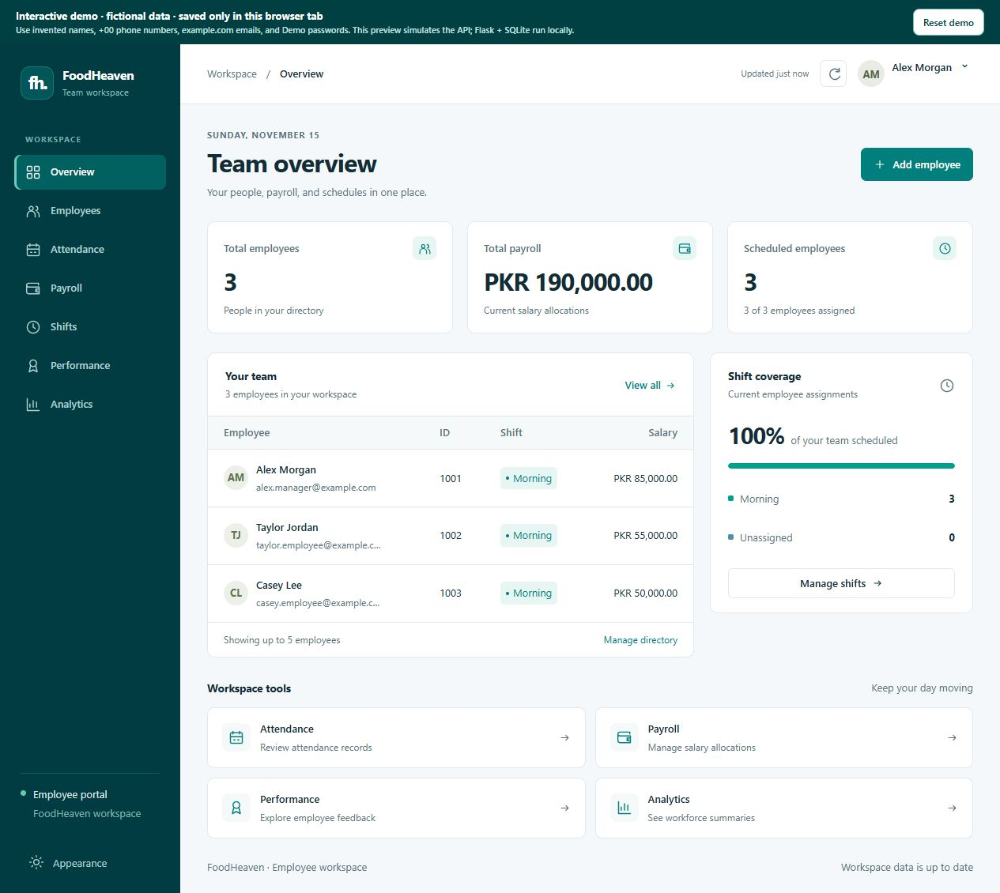

# FoodHeaven

[](https://github.com/saadh472/foodheaven/actions/workflows/quality.yml)

A full-stack employee management portal built with Flask and JavaScript. Manage employees, payroll, and shifts; review attendance, performance, and workforce analytics. The interface and API run together on one local server.

**Stack:** Python · Flask · SQLite · optional SQL Server · HTML, CSS, JavaScript

[Try the public interactive demo](https://saadh472.github.io/foodheaven/) · [Screenshot walkthrough](docs/WALKTHROUGH.md) · [Security policy](SECURITY.md)



The public preview runs the current interface with a browser-only API simulator and fictional records. Changes stay in this browser tab, and **Reset demo** restores the sample workspace. It does not host Flask or store shared employee records. Run the application locally below to use the real Flask API and persistent SQLite database. Use invented names, `example.com` email addresses, and `+00` phone numbers in the public preview.

## Features

- **Employee management:** search, create, edit, and delete employee records with persistent database storage.
- **Payroll and shifts:** update salary amounts and working schedules with server-side validation.
- **Attendance and performance:** inspect workforce records and dashboard summaries.
- **Manager sessions:** signed session cookies, hashed passwords, authenticated API routes, and CSRF protection for changes.
- **Local demo database:** start with fictional data in SQLite; keep your records between restarts.
- **SQL Server option:** configure an explicit database backend for the original SQL Server workflow.
- **One application:** relative frontend links and API requests work across ports without a separate frontend server.
- **Consistent interface:** shared light and dark themes, responsive navigation, readable tables, and keyboard controls.
- **Recoverable frontend:** explicit loading and retry states, retained snapshots, duplicate-submit prevention, and guarded uncertain writes.

## Quick start

Install Python 3.11 or newer. On Windows, double-click **[launcher/Start FoodHeaven.cmd](launcher/Start%20FoodHeaven.cmd)**. The launcher creates a local virtual environment, installs dependencies, and starts the app. Keep the terminal open while using it.

You can also start it manually from the repository root.

To get a fresh copy, clone [saadh472/foodheaven](https://github.com/saadh472/foodheaven) and open the downloaded folder:

```sh
git clone https://github.com/saadh472/foodheaven.git
cd foodheaven
```

### Windows PowerShell

```powershell
python -m venv .venv
.\.venv\Scripts\python.exe -m pip install -r requirements.txt
.\.venv\Scripts\python.exe backend/app.py
```

### macOS or Linux

```sh
python3 -m venv .venv
.venv/bin/python -m pip install -r requirements.txt
.venv/bin/python backend/app.py
```

Open [http://127.0.0.1:5000/](http://127.0.0.1:5000/).

| Demo login ID | Demo password |
| --- | --- |
| `1001` | `DemoPass123!` |

The first SQLite run creates a fictional demo database under `instance/`. Later starts keep the saved data and password changes. Use **Change password** from the signed-in account to update the demo password. Stop the server with Ctrl+C.

If port 5000 is busy, set `$env:API_PORT = "5001"` in PowerShell before starting, then open that port. No Node build step is required. Some visual enhancements use Google Fonts or Chart.js from a CDN.

## Try a complete workflow

1. Sign in with the demo account and inspect the dashboard.
2. Open **Employee Details**, add a fictional employee, edit the record, then reload to verify persistence.
3. Update the employee's salary under **Payroll** and schedule under **Shift Scheduling**.
4. Review **Attendance**, **Performance**, and **Analytics**.
5. Change the manager password, sign out, and sign back in with the new password.

Changes apply to the selected local database. Input errors leave existing records intact. Database failures are reported as errors rather than silently switching to demo data.

## Database options

SQLite is the default and needs no separate database server. Its database and session key stay in the ignored `instance/` folder.

SQL Server is an explicit opt-in using `DB_BACKEND=sqlserver`, a compatible Microsoft ODBC driver, and a dedicated schema. See the [backend guide](backend/README.md) for setup, environment settings, and API details. The app does not restore or upload database backups.

## Project layout

```text
foodheaven/
├── backend/                  # Flask routes, services, repositories, schema, tests
├── frontend/                 # Dashboard, portal screens, shared API helper, tests
├── launcher/                 # CMD launcher and PowerShell startup helper
│   └── Start FoodHeaven.cmd
├── .github/workflows/quality.yml
└── requirements.txt
```

See the [frontend guide](frontend/README.md) for the screens and shared browser behavior.

## Verification

Use the virtual environment interpreter from the quick start. Node.js 24 or newer runs the frontend regression checks.

```powershell
.\.venv\Scripts\python.exe -m unittest discover -s backend/tests -v
.\.venv\Scripts\python.exe -m unittest discover -s frontend/tests -v
npm ci --prefix frontend --ignore-scripts --no-fund --no-audit
npm test --prefix frontend
```

On macOS or Linux, use `.venv/bin/python`. GitHub Actions runs the checks on Windows and Linux. DOM tests exercise frontend failures, retries, form validation, keyboard behavior, and control sizing. SQLite integration tests use isolated temporary databases; SQL Server needs a separately configured instance for live verification.

## Scope

This is a university project improved for a reproducible local demonstration. It binds to loopback by default. Public hosting would require deployment configuration, HTTPS, account administration, and operational monitoring. Email-based password recovery is disabled until a verified reset-token flow is configured.

The repository combines the original FoodHeaven UI and API work. The former component repositories retain their history; this repository is the home for continued development.

## Public preview development

Node.js 24 runs the isolated demo checks and builds the GitHub Pages artifact. The build copies interface assets and injects the demo adapter only into the generated `dist/` directory; it never changes the local Flask interface or copies database files.

```sh
npm ci --prefix frontend --ignore-scripts
node --test demo/adapter.test.cjs demo/browser.test.cjs
node scripts/build-demo.mjs
node --test demo/build.test.cjs
node scripts/preview-demo.mjs
```

Open `http://127.0.0.1:3200/foodheaven/`. The publication workflow validates the adapter before deploying the generated artifact. `dist/` is ignored by Git.

## Security and reuse

Dependency alerts, secret scanning, and code scanning are enabled for this public repository. See [SECURITY.md](SECURITY.md) to report a vulnerability privately. These checks complement review and do not establish production readiness.

Original application code is available under the [MIT license](LICENSE). Existing dependency and legacy-asset attribution is documented in [THIRD_PARTY_NOTICES.md](THIRD_PARTY_NOTICES.md); assets without established provenance are excluded from that grant.
