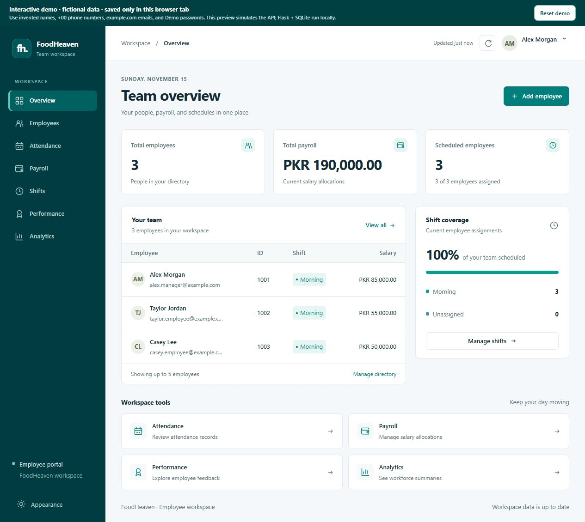
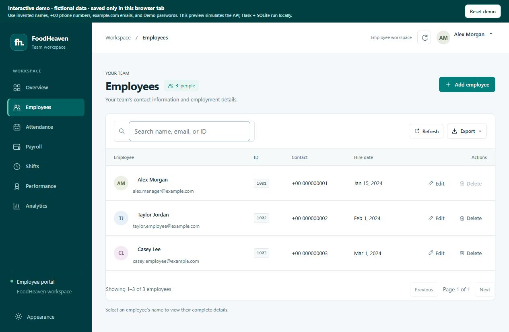

# FoodHeaven walkthrough

These screenshots show the current interface using fictional records. The public preview displays a persistent banner explaining its browser-only storage. The local application uses the same pages with a Flask API and SQLite persistence.

## 1. Review the team

Open the [public demo](https://saadh472.github.io/foodheaven/), choose **Use demo account**, then **Sign in**. The initial account is `1001` / `DemoPass123!`. The overview shows three employees, PKR 190,000 in salary allocations, and three scheduled employees.

## 2. Manage a fictional employee

Open **Employees**. Search by name, ID, or email. Choose **Add employee** and enter a new ID, an invented name, a fictional phone beginning `+00`, and an email such as `jamie@example.com`. Save, inspect the employee's details, and edit the record. The signed-in manager cannot be deleted from the directory.

## 3. Complete the workflow

Open **Payroll** to set the new employee's salary, then **Shifts** to assign a working period. Review **Attendance**, **Performance**, and **Analytics**. Use the account menu to sign out. The public preview's **Reset demo** button clears the fictional changes for this tab.

## Verify real persistence locally

Follow the root README's local setup. Add a fictional employee, stop Flask, and start it again. Sign in and find the saved employee. Its data comes from the ignored `instance/foodheaven.sqlite3` file. In contrast, closing the public preview tab normally discards that tab's simulated records.

## Demo boundaries

The public preview is a UI demonstration, not server authentication or a shared database. Do not enter real credentials or personal information. Simulated password changes must use a demo password; reset the preview to recover the published sample account. The local application performs server-side session checks, password hashing, CSRF validation, and SQLite transactions.
